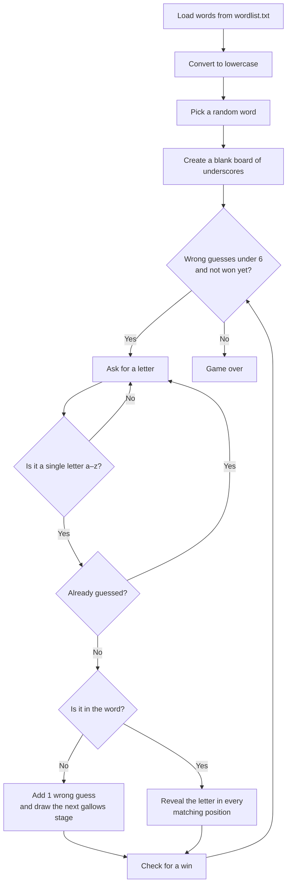

# 🎯 Hangman


A command-line Hangman game written in pure Python. The game picks a random word from an editable word list, and the player has to guess it one letter at a time before the hangman is fully drawn.

I built this project from scratch to practise core programming fundamentals: game loops, input validation, managing game state, and reading data from files.

---

## 📋 Table of Contents

- [Features](#-features)
- [Demo](#-demo)
- [Getting Started](#-getting-started)
- [How to Play](#%EF%B8%8F-how-to-play)
- [How It Works](#%EF%B8%8F-how-it-works)
- [Project Structure](#-project-structure)
- [Customising the Word List](#-customising-the-word-list)
- [What I Learned](#-what-i-learned)
- [Roadmap](#%EF%B8%8F-roadmap)
- [Author](#-author)

---

## ✨ Features

- **Random word selection**: each game picks a new word from `wordlist.txt`
- **External word list**: words are loaded from a text file, so new words can be added without touching the code
- **Case normalisation**: every word is converted to lowercase on load, so `Quarter` and `quarter` behave the same
- **ASCII-art gallows**: a 7-stage drawing that builds up with every wrong guess
- **Input validation**: only single letters from a–z are accepted, and the player is asked again otherwise
- **Repeat-guess protection**: the game spots letters that have already been guessed and asks for a new one
- **Used-letters tracker**: shows every letter guessed so far at the start of each turn
- **Live word progress**: reveals correctly guessed letters in every position they appear (e.g. `_a__`)
- **Win and lose detection**: the game ends when the word is complete or after 6 wrong guesses

---

## 🎮 Demo

Example game where the hidden word is `lamp` (typed input shown after each prompt):

```
These are all the letters you've used: []
enter a letter: a
        ______
        |    |
        |    |
             |
             |
             |

_a__
These are all the letters you've used: ['a']
enter a letter: z
This letter is not in the word!
        ______
        |    |
        |    |
        O    |
             |
             |
             |
             |

_a__
These are all the letters you've used: ['a', 'z']
enter a letter: a
These are all the letters you've used: ['a', 'z']
You've already used this letter, pick a different one: l
...
lamp
You got the word right!
```

---

## 🚀 Getting Started

### Prerequisites

- [Python 3](https://www.python.org/downloads/)
- No external libraries needed. The game only uses Python's built-in `random` module.

### Installation

```bash
git clone https://github.com/varshansasikumar73/hangman.git
cd hangman
python3 main.py
```

> **Note:** run the game from inside the `hangman` folder so it can find `wordlist.txt`.

---

## 🕹️ How to Play

1. A random word is chosen and shown as underscores, one per letter.
2. Type a single lowercase letter and press **Enter**.
3. **Correct guess:** the letter is revealed everywhere it appears in the word.
4. **Wrong guess:** another part of the hangman is drawn.
5. You can make **6 wrong guesses**. On the 6th, the drawing is complete and you lose.
6. Reveal every letter before that happens to win.

---

## ⚙️ How It Works

### Game flow



### Key parts of the code

| Part | What it does |
|---|---|
| **Loading words** | Opens `wordlist.txt` with a `with` block, splits it into lines, and builds a lowercase list of words |
| **The board** | The word is stored as a list of letters (`chosen`), and a matching list of underscores (`spaces`) shows the player's progress |
| **Revealing letters** | `enumerate()` loops over the word with each letter's position, so a correct guess is filled in at **every** matching position, not just the first |
| **`gallows()`** | Picks which of the 7 ASCII-art stages to print based on the number of wrong guesses |
| **`DID_YOU_WIN()`** | Compares the player's board to the hidden word, and sets `winner` to `True` once they match |
| **`guess_letter()`** | The main game loop. It keeps running while the player has guesses left and hasn't won yet |
| **Game state** | The wrong-guess counter, used letters and win status are shared between functions as global variables |

---

## 📁 Project Structure

```
hangman/
├── main.py         # Game logic: word loading, game loop, gallows drawings
├── wordlist.txt    # Words the game picks from (one per line)
└── README.md       # Project documentation
```

---

## 📝 Customising the Word List

Open `wordlist.txt` and add, remove or change words, **one word per line**:

```
Quarter
Centre
Jungle
Timetable
```

Capital letters are fine, because the game converts every word to lowercase when it loads.

---

## 🧠 What I Learned

- **File handling**: reading external data with `open()` and a `with` block, which closes the file automatically
- **Lists and iteration**: building, changing and comparing lists, and using `enumerate()` to track positions
- **Input validation**: using `while` loops to keep asking until the input is valid
- **Game loops and state**: tracking lives, guesses and win conditions across many turns
- **Functions and scope**: splitting the program into functions, and using the `global` keyword so a function can change a variable defined outside it
- **String formatting**: f-strings, `"".join()` for displaying the board, and raw strings (`r"""..."""`) so the ASCII art's backslashes print correctly
- **Debugging**: working through errors like `UnboundLocalError` to understand how Python decides whether a variable is local or global

---

## 🗺️ Roadmap

Ideas for future versions:

- [ ] "Play again?" option at the end of a game
- [ ] Difficulty levels based on word length
- [ ] Score tracking across multiple rounds
- [ ] Word categories (animals, places, objects, …)

---

## 👤 Author

**[@varshansasikumar73](https://github.com/varshansasikumar73)**

If you have feedback or suggestions, feel free to open an issue!
